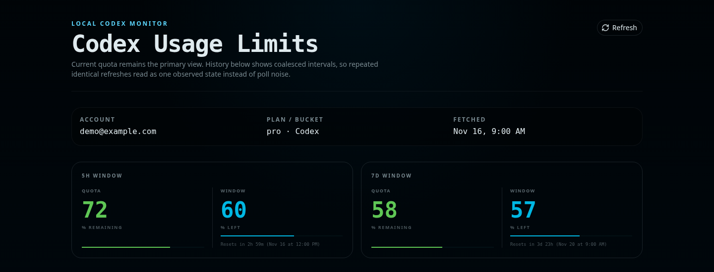

# Codex Usage Limit Dashboard

A local CLI and browser dashboard for viewing Codex rate-limit usage, reset times,
and SQLite usage history through the official `codex app-server` JSON-RPC API.
This is an independent project, not an official OpenAI product.

**Distribution:** run locally from a source checkout. There is no published npm
CLI package or hosted service. The API and browser servers bind to `127.0.0.1`.



Example live view with synthetic account data; history continues below it.

[Requirements](#requirements) · [Quick start](#quick-start) ·
[Usage](#usage) · [Configuration](#configuration) ·
[History and privacy](#history-and-privacy) ·
[Troubleshooting](#troubleshooting) · [Development](#development) ·
[License](#license)

## Requirements

- [Node.js 22](https://nodejs.org/en/download) and npm. Select Node **before**
  installing dependencies; SQLite includes a native module tied to the Node ABI.
- [pnpm](https://github.com/pnpm/pnpm#installation) **10.34.9**, pinned in `package.json`.
  Install with `npm install --global pnpm@10.34.9` if needed.
- [Codex CLI](https://github.com/openai/codex#quickstart), installed with
  `npm install --global @openai/codex`, available on `PATH` as `codex`.
  Use a current stable version with `codex app-server` support.
- A ChatGPT account with Codex access and internet access for authentication and
  live rate-limit queries.
- Git to clone the repository. If a SQLite prebuilt binary is unavailable, install
  Python and a C/C++ build toolchain; see [node-gyp installation](https://github.com/nodejs/node-gyp#installation).

Node 22.23.5 and pnpm 10.34.9 are the local verification baseline. CI checks Linux,
macOS, and Windows on Node 22. Live-account compatibility is not covered by CI;
include `codex --version` when reporting an upstream API issue.

## Quick start

This repository requires access. Authenticate Git with a GitHub account that has
been granted access before cloning; unauthenticated requests may return 404.
Clone the repository and enter it:

```sh
git clone https://github.com/ShahalKP/codex-usage-limit-dashboard.git
cd codex-usage-limit-dashboard
```

If you use [nvm](https://github.com/nvm-sh/nvm#installing-and-updating), run
`nvm install` and `nvm use` here. nvm is optional if Node 22 is already installed.

Verify the prerequisites, then install **all** app dependencies from the root:

```sh
node --version
pnpm --version
codex --version
pnpm install --frozen-lockfile
```

The checked-in `pnpm-workspace.yaml` permits the required native/bundler install
scripts. No separate install inside `web/` is needed.

If Codex is not already authenticated:

```sh
pnpm run login
```

Follow the displayed verification URL and device code in your browser. The
command exits after successful login. Existing Codex CLI authentication is reused.

Fetch a terminal report:

```sh
pnpm run usage
```

Or start the browser dashboard:

```sh
pnpm run dev
```

Open <http://127.0.0.1:5173>. The API runs on port 8787. Press Ctrl+C in the
terminal to stop both servers. The dashboard refreshes every 60 seconds while open.

## Usage

### Terminal

```sh
pnpm run usage
pnpm run usage -- --watch
pnpm run usage:json
pnpm exec tsx src/cli.ts --help
```

The terminal report shows account information, remaining quota, and reset times.
Progress bars use green below 60% used, yellow from 60% to below 80%, and red at
80% or more. In watch mode, press `r` to refresh or `q` / Esc to quit.

Use `pnpm --silent run usage:json` when piping JSON to another program, so pnpm's
script banner is suppressed. `--json` produces one snapshot even with `--watch`.
For an optional command that works outside the checkout, see the
[global wrapper instructions](docs/global-command.md).

### Browser and local build preview

The dashboard combines the live snapshot, primary/secondary quota trends, recent
history intervals, and controls for selecting or deleting a history range.

`pnpm run dev` runs the API from TypeScript and Vite with frontend hot reload.
Restart it after changing backend code. To inspect the compiled application locally:

```sh
pnpm run build
pnpm run preview
```

Open <http://127.0.0.1:4173>. Preview runs the compiled API and Vite's local preview
server; it is not a public deployment setup. Express serves API routes only.
Both development and preview proxy `/api` to the local API.

### History commands

```sh
pnpm exec tsx src/cli.ts history --range 24h
pnpm exec tsx src/cli.ts history --range all --window secondary
pnpm exec tsx src/cli.ts history --range 30d --limit 25 --json
pnpm exec tsx src/cli.ts history:clear --range 7d
```

Ranges are `24h`, `7d`, `30d`, and `all`. Listing defaults to `24h` and 10 events;
`--limit` is capped at 200. `--window` selects the terminal summary, not which
snapshot fields appear in JSON.

**Deletion semantics:** `history:clear --range 7d` deletes entire coalesced
intervals whose **last observation is within the past seven days**, including an
interval that started earlier. It does not delete only records older than seven
days. Omitting `--range` from the CLI cleanup command selects **all history**.
Cleanup asks for confirmation; `--yes` explicitly skips that prompt.

## Configuration

Set environment variables in the shell that launches the app. `.env` files are
not automatically loaded by the API.

| Variable | Default | Purpose |
| --- | --- | --- |
| `CODEX_BIN` | `codex` from `PATH` | Path to the Codex executable; do not include command arguments. |
| `PORT` | `8787` | API port; the development and preview proxies use the same value. |
| `CODEX_USAGE_DB_PATH` | Platform path below | History database file; relative paths resolve from the process working directory. |
| `XDG_DATA_HOME` | `~/.local/share` on Linux | Linux data directory when no explicit database path is set. |
| `APPDATA` | User roaming application-data directory on Windows | Windows data directory when no explicit database path is set. |

For example, in a POSIX shell:

```sh
PORT=8788 pnpm run dev
```

In PowerShell:

```powershell
$env:PORT = '8788'
pnpm run dev
```

If starting the API and frontend in separate terminals, set the same `PORT` in
both. To use another frontend port, run `pnpm run server` in one terminal and
`pnpm run web -- --port 5174` in another. The servers fail if their selected port
is occupied rather than silently changing the documented URL.

## History and privacy

Every successful live fetch attempts to save a validated snapshot before returning.
This includes terminal reports, watch mode, and browser requests. Nothing records
in the background after these processes stop, and missed periods are not backfilled.
Consecutive identical snapshots are coalesced by updating the last observation
and occurrence count. Failed live fetches create no rows; failed persistence
leaves the live result available with a warning.

History includes account email, account/plan type, quota percentages, reset times,
and the validated snapshot payload. Tokens and credentials are not stored in the
history database; authentication is handled by Codex. The database is an ordinary,
unencrypted SQLite file. Avoid sharing it or unredacted JSON output publicly.

Default locations:

| Platform | Database file |
| --- | --- |
| macOS | `~/Library/Application Support/codex-usage-limit-dashboard/history.sqlite` |
| Linux | `${XDG_DATA_HOME:-~/.local/share}/codex-usage-limit-dashboard/history.sqlite` |
| Windows | `%APPDATA%\codex-usage-limit-dashboard\history.sqlite` |

There is **no automatic expiration or retention limit**. Use the history cleanup
controls to remove rows. To back up history, stop all CLI/watch and dashboard
processes, then copy the database and any adjacent `history.sqlite-wal` and
`history.sqlite-shm` files together. Restore them together while the app is stopped.
To remove all stored history files, stop the app and delete that same file set;
the next successful fetch creates a new database. SQL row deletion is not a secure
erasure guarantee and does not delete backups.

The app uses `account/read` and `account/rateLimits/read`, not web-page scraping.
It reports quota percentages and reset times, not absolute message/token counts
or billing totals. Bucket selection prefers `codex`, then a Codex-like bucket,
then the legacy `rateLimits` value, then the first available bucket.

Browser/API traffic stays on loopback, while Codex communicates with OpenAI for
live account data. Do not expose the API or frontend servers publicly: the local
API has no application-level authentication and includes a history deletion route.

## Troubleshooting

| Symptom | Action |
| --- | --- |
| `pnpm` or `codex` not found | Install the prerequisites, reopen your terminal, and check `PATH`; use `CODEX_BIN` for a custom Codex executable. |
| Node engine warning | Select Node 22 before installing or running. Confirm with `node --version`. |
| SQLite `NODE_MODULE_VERSION` mismatch / module did not self-register | Select Node 22, then run `pnpm rebuild better-sqlite3`. Rebuild after switching Node versions. |
| SQLite binary missing or install scripts blocked | Check `pnpm-workspace.yaml`; if local policy still blocks builds, run `pnpm approve-builds`, approve only the required packages, then `pnpm rebuild better-sqlite3 esbuild`. |
| SQLite compilation fails | Install the native build prerequisites linked above and retry `pnpm rebuild better-sqlite3`. |
| Not logged in | Run `pnpm run login` using the same `CODEX_BIN` as the dashboard. |
| Unknown plan variant, including `prolite` | Upgrade with `npm install --global @openai/codex@latest`, or point `CODEX_BIN` to a newer binary. |
| API timeout or unavailable usage | Check network access, authentication, and `codex --version`; upstream availability and response formats can change. |
| Address already in use | Stop the other process or choose another port using the configuration examples. |
| Proxy connection refused | Ensure the API is running and both terminals use the same `PORT`. |
| History warning | Verify that the database directory is writable and has free space. Back up the file before attempting repairs. |

For help, [open an issue](https://github.com/ShahalKP/codex-usage-limit-dashboard/issues)
(repository access required)
with OS, Node/pnpm/Codex versions, the command used, and redacted errors. Never
include tokens, authentication files, or your history database.

## Development

```sh
pnpm test
pnpm run build
pnpm run check:docs
pnpm run check:links
pnpm run smoke
```

See [CONTRIBUTING.md](CONTRIBUTING.md) for architecture, build outputs, checks,
and contribution expectations. The repository uses one root package and lockfile.
CI installs from that lockfile, runs tests and builds, checks documentation, and
smoke-tests local servers without a Codex account. External links are also checked
on a weekly schedule.

## License

[MIT](LICENSE). Copyright (c) 2026 Codex Usage Limit Dashboard contributors.
